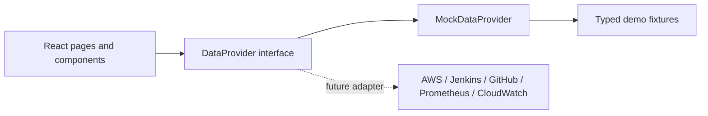
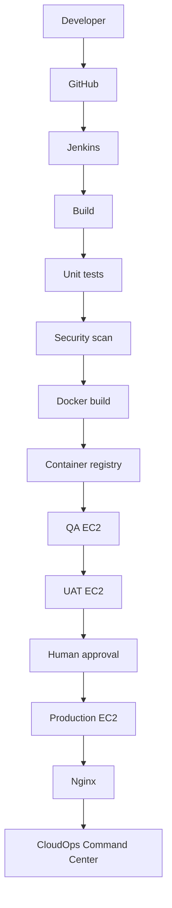
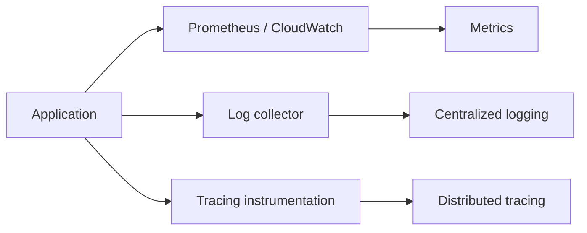

# CloudOps Command Center

CloudOps Command Center is a local-first internal engineering platform for understanding service ownership, operational risk, releases, incidents, infrastructure, reliability, cloud cost, and security from one place. It is a portfolio project backed entirely by realistic demo data. It does not connect to AWS, Jenkins, GitHub, Prometheus, CloudWatch, or any other external service.

## Features

- Operational command center with environment health, risk signals, and activity
- Service catalog and dependency impact map
- Deployment, pipeline, release, incident, change, and runbook workflows
- Infrastructure inventory for environments, servers, containers, and relationships
- Metrics, structured logs, and distributed trace views
- Cloud cost trends, budget status, and savings opportunities
- SLO, SLA, SLI, error budget, and reliability reporting
- Security findings and searchable audit history
- Engineering delivery analytics focused on process and system metrics, not employee rankings
- Keyboard-accessible navigation, global search and command palette, responsive layout, and dark/light themes
- Local-only simulations for incident acknowledgement, alert resolution, deployment progress, and production approvals

All actions and records are demonstrations. Production approval is simulated and does not authorize or trigger a real deployment.

## Technology

- React and TypeScript
- Vite
- Tailwind CSS and Radix UI components
- Wouter routing
- TanStack Query (available in the scaffold)
- Recharts
- Lucide icons

## Architecture

The frontend consumes a typed provider boundary. The mock provider is the only implementation currently included. It keeps sample records out of page components and makes the UI independent of a future transport or vendor integration.



The future adapter is a design seam only. No external provider, credential handling, cloud provisioning, or backend is included.

### Source layout

```text
artifacts/cloudops-command-center/
├── README.md
├── .env.example
├── package.json
├── vite.config.ts
└── src/
    ├── App.tsx
    ├── components/       reusable shell and domain UI
    ├── data/             provider contract and mock data
    ├── hooks/            UI state and interaction hooks
    ├── lib/              formatting and shared utilities
    ├── pages/            routed product areas
    └── types/            shared domain types
```

## Run locally

Run the app from the root of this pnpm workspace:

```bash
pnpm install
BASE_PATH=/ PORT=5173 pnpm --filter @workspace/cloudops-command-center run dev
```

Open the local address printed by Vite. The port and base path shown above are for a local run; they do not publish or host the app.

Type-check the frontend:

```bash
pnpm --filter @workspace/cloudops-command-center run typecheck
```

Build the static frontend bundle:

```bash
BASE_PATH=/ PORT=5173 pnpm --filter @workspace/cloudops-command-center run build
```

The app does not require a database, API server, AWS account, API key, or `.env` file to run in mock mode.

## Mock data

The mock dataset covers environments, services, deployments, incidents, alerts, servers, time-series metrics, structured logs, traces, changes, runbooks, cost records, audit events, and engineering/reliability summaries. The provider returns typed data and accepts local demo actions; UI components should access data through this boundary rather than embedding fixtures.

The interface clearly labels the data as a demonstration. Simulated actions are local to the browser session unless the application explicitly persists the relevant UI preference.

## Adding a real provider later

Do not put vendor SDK calls in React components. To integrate a real source in a future project iteration:

1. Keep the domain types and `DataProvider` contract as the UI-facing boundary.
2. Implement an adapter such as `AWSDataProvider`, `JenkinsDataProvider`, `GitHubDataProvider`, `PrometheusDataProvider`, or `CloudWatchDataProvider`.
3. Put authenticated vendor calls behind a server-side API; do not expose secrets in `VITE_*` variables or commit credentials.
4. Validate, normalize, and scope provider responses before exposing them to the interface.
5. Select providers through explicit configuration and test their unavailable, partial-data, and error states.

These steps describe future work. There is no AWS/Jenkins/monitoring integration in this source.

## Future DevOps architecture

An example deployment pipeline for a future implementation:



Future observability could route application telemetry to metrics, centralized logging, and distributed tracing systems:



Neither architecture is provisioned or connected by this project.

## Security

- The current app uses mock data only and has no secrets.
- `.env.example` documents the absence of local environment requirements.
- Never commit AWS access keys, GitHub tokens, Jenkins credentials, passwords, private keys, or other secrets.
- Future integrations should keep credentials server-side and use the hosting environment's secret manager.